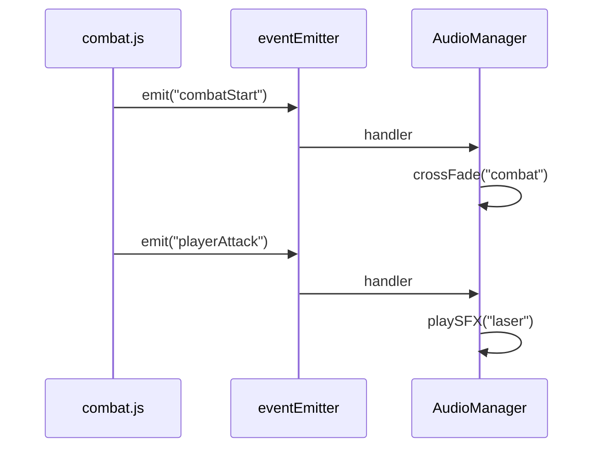

# Adaptive Audio Engine

Music and sound effects react to combat. Combat logic never calls audio directly. It emits named events on a shared event bus, and the audio manager listens. That keeps `systems/combat.js` free of audio code and lets other systems react to the same events later.

## Files

| File | Role |
|---|---|
| [`systems/eventEmitter.js`](../systems/eventEmitter.js) | `EventEmitter` class (`on`, `off`, `emit`) and the shared `eventEmitter` singleton. |
| [`systems/audio.js`](../systems/audio.js) | `AudioManager`, `initAudio()`, `getAudioManager()`. |
| [`systems/combat.js`](../systems/combat.js) | Emits the combat events listed below. |
| [`game.js`](../game.js) | Calls `initAudio()` at the end of `initializeGame()`. |
| [`assets/audio/`](../assets/audio/) | Music loops and SFX (currently silent placeholders). |
| [`tests/systems/audio.test.js`](../tests/systems/audio.test.js), [`eventEmitter.test.js`](../tests/systems/eventEmitter.test.js), [`combat.test.js`](../tests/systems/combat.test.js) | Unit tests. |

## Flow



## Event reference

| Event | Emitted from (`combat.js`) | Audio response |
|---|---|---|
| `combatStart` | `encounterEnemy()`, after `gameState = "combat"` | Crossfade to **combat** |
| `bossPhase` | `encounterBoss()`, after the boss is set up | Crossfade to **boss** |
| `combatIntense` | `enemyTurn()`, the first time player HP drops below 30% of max in a fight (guarded by `state.combatIntenseTriggered`, reset on each encounter) | Crossfade to **intense** |
| `combatEnd` | `winCombat()`, and every defeat path (attack, block, dodge, special, enemy turn, vacuum suffocation) | Crossfade to **ambient** |
| `playerAttack` | `playerAttack()`, after the AP check passes | SFX **laser** |
| `enemyAttack` | Start of `enemyTurn()` | SFX **hit** |
| `explosion` | `winCombat()`, when a Magma Elemental dies | SFX **explosion** |
| `playerDodge` | `playerDodge()` | No listener yet |

Events carry no payload today. `emit(event, ...args)` supports arguments if a listener needs context (for example, the enemy name).

## Tracks and SFX

| Key | File | Type |
|---|---|---|
| `ambient` | `ambient_space.mp3` | Music, loops |
| `combat` | `combat_normal.mp3` | Music, loops |
| `intense` | `combat_intense.mp3` | Music, loops |
| `boss` | `boss_battle.mp3` | Music, loops |
| `laser`, `hit`, `explosion` | `sfx_laser.mp3`, `sfx_hit.mp3`, `sfx_explosion.mp3` | SFX, wired to events |
| `success`, `failure`, `click`, `warp` | `sfx_*.mp3` | SFX, loaded but not wired to anything yet |

To swap in real audio, replace the files in `assets/audio/` and keep the same names. No code change is needed.

## AudioManager API

```js
import { initAudio, getAudioManager } from './systems/audio.js';

const audio = initAudio();   // idempotent; returns the same instance every time
getAudioManager();           // the instance, or null before initAudio()

audio.playTrack('ambient');  // hard switch, no fade
audio.crossFade('boss', 800);// fade old out / new in over ms (default 800, 50ms steps)
audio.playSFX('laser');      // restarts the clip from 0
audio.setVolume(0.5);        // 0..1, applies to music and future SFX
audio.mute(true);            // mute(false) to restore
audio.destroy();             // removes listeners, stops music, clears fades
```

Behavior notes:

- **Autoplay policy.** Browsers block audio until the user interacts with the page, so the constructor doesn't play anything. It registers a one-time `pointerdown`/`keydown` listener on `document` that starts the ambient track, then removes itself.
- **Safe playback.** Every `play()` goes through `_safePlay()`, which swallows rejected promises and tolerates `play()` returning `undefined` (jsdom). Audio failures never break the game.
- **Crossfade** is a no-op if the requested track is already playing. Starting a new fade cancels any fade in progress. When a fade finishes, the old track is paused and rewound.

## Adding a new sound

1. Drop the file into `assets/audio/`.
2. Add it to `this.tracks` (music) or `this.sfx` in the `AudioManager` constructor.
3. Emit an event from the relevant system: `eventEmitter.emit('myEvent')`.
4. Register a handler in `_wireEvents()` via `register('myEvent', () => this.playSFX('mySound'))`. Using `register` (not `eventEmitter.on` directly) lets `destroy()` clean the handler up.
5. Add a test in `tests/systems/audio.test.js`.

## Testing

jsdom doesn't implement media playback, so the tests stub `HTMLMediaElement.prototype.play`/`pause`, use Jest fake timers for crossfades, and call `_resetAudioForTesting()` between tests to drop the singleton and its listeners.

```bash
npx jest tests/systems/audio.test.js tests/systems/eventEmitter.test.js tests/systems/combat.test.js
```

## Known gaps

- No volume/mute control in the settings UI yet. The API exists, but nothing calls it.
- `combatIntense` only goes one way. If the player heals above 30%, the music stays intense until combat ends.
- There's no flee action in combat today. If one is added, it must emit `combatEnd`.
