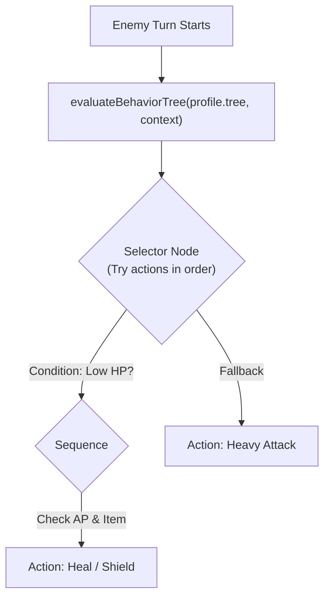

# Behavior Tree AI

Galactic Odyssey uses a declarative Behavior Tree (BT) engine for advanced enemy tactical decision-making in combat. Instead of rigid `switch`/`case` state machines, enemies evaluate hierarchical behavior trees composed of selector, sequence, condition, and action nodes to choose their actions.

## Files

| File | Role |
|---|---|
| [`systems/ai/behaviorTree.js`](../systems/ai/behaviorTree.js) | Core BT engine: defines `NODE_STATUS`, `selector`, `sequence`, `condition`, `action`, `evaluateBehaviorTree`, and profile compilers (`compileBehaviorTree`, `createAIProfile`). |
| [`data/enemies.js`](../data/enemies.js) | Enemy data containing `aiProfile` descriptors (e.g., Aggressive, Defensive, Tactical, Swarm). |
| [`systems/combat.js`](../systems/combat.js) | Combat loop integration: runs `enemyTurn()` which executes the enemy's compiled behavior tree to select attacks, heals, or tactical actions. |
| [`tests/systems/behaviorTree.test.js`](../tests/systems/behaviorTree.test.js) | Comprehensive unit tests verifying selectors, sequences, conditions, actions, and profile compilation. |

## Architecture & Flow



## Core Node API & Statuses

Nodes return one of three status codes from `NODE_STATUS`:
- `SUCCESS`: Execution completed successfully.
- `FAILURE`: Execution failed or condition not met.
- `RUNNING`: Execution is ongoing (supported for multi-turn/stateful actions).

### Primitives
- `selector(...children)`: Evaluates children in order; returns `SUCCESS` on the first child that returns `SUCCESS`, else `FAILURE`.
- `sequence(...children)`: Evaluates children in order; returns `FAILURE` on the first child that returns `FAILURE`, else `SUCCESS`.
- `condition(predicate)`: Evaluates `predicate(context)`, returning `SUCCESS` if truthy, else `FAILURE`.
- `action(fn)`: Executes `fn(context)`, coercing return values into `NODE_STATUS`.

## Profile Compilation & Built-in AI Profiles

`createAIProfile(definition)` compiles declarative JSON-like or constructor-based rule sets into executable behavior trees stored on enemy records in [`data/enemies.js`](../data/enemies.js). Common profiles include:
- **Aggressive**: Prioritizes heavy attacks and offensive buffs when energy allows.
- **Defensive**: Evaluates shields and healing actions when HP falls below thresholds.
- **Tactical**: Mixes status debuffs, probing attacks, and critical strikes based on player vulnerability.

## Testing

```bash
npx jest tests/systems/behaviorTree.test.js
```

## Known Gaps

- Advanced pathfinding or spatial positioning nodes are not implemented since combat is abstracted as a turn-based exchange.
