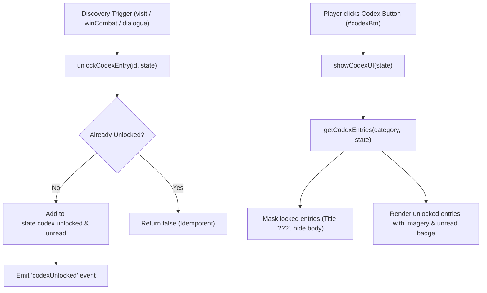

# Codex Lore & Encyclopedia

The Codex is the in-game lore repository and encyclopedia of Galactic Odyssey. It catalogs discovery entries across five categories—locations, factions, enemies, technology, and characters—tracking player unlock progress, unread notification badges, and lore persistence across saves and legacy saves.

## Files

| File | Role |
|---|---|
| [`data/codex.js`](../data/codex.js) | Category metadata (`CODEX_CATEGORIES`, `CODEX_CATEGORY_META`) and all lore entries (`codexEntries`) covering locations, districts, factions, enemies, bosses, technology, and characters. |
| [`systems/codex.js`](../systems/codex.js) | Core lore state management: `ensureCodexState(state)`, `unlockCodexEntry(id, state)`, `markCodexRead(id, state)`, `isCodexUnlocked(id, state)`, `getCodexEntries(category, state)`, and `getCodexProgress(state)`. Emits `codexUnlocked` events. |
| [`systems/ui/codex-ui.js`](../systems/ui/codex-ui.js) | Presentation sub-module (`showCodexUI`, `closeCodexUI`) rendering the modal, category tabs, progress bar, entry list with unread badges, and detailed viewer with imagery lookups (`data/imagery.js`). |
| [`systems/saveload.js`](../systems/saveload.js) | Persists `state.codex` (`unlocked` array, `unread` array) and migrates older saves via `ensureCodexState()`. |
| [`systems/character.js`](../systems/character.js), [`systems/locations.js`](../systems/locations.js), [`systems/combat.js`](../systems/combat.js), [`systems/ui/dialogue-ui.js`](../systems/ui/dialogue-ui.js), [`systems/ui/districts-ui.js`](../systems/ui/districts-ui.js) | Auto-unlock hooks triggered upon visiting locations, winning combat against enemies/bosses, and speaking with NPCs. |
| [`index.html`](../index.html) | Codex modal markup (`#codexModal`) and the HUD toolbar button (`#codexBtn`). |
| [`tests/systems/codex.test.js`](../tests/systems/codex.test.js) | Comprehensive Jest test suite covering state migration, unlocking, idempotency, masking locked entries, UI rendering, imagery integration, and completeness against `data/locations.js` and `data/enemies.js`. |

## Architecture & Flow



## Codex Categories & Entry Schema

Each entry in `data/codex.js` follows a strict schema:

```js
{
    id: 'terra_prime',            // Unique string identifier
    category: 'locations',        // One of CODEX_CATEGORIES
    title: 'Terra Prime',         // Display title (masked as '???' when locked)
    summary: 'Brief teaser...',    // Short summary description
    body: 'Detailed lore text...', // Full lore body (hidden when locked)
    unlockHint: 'Visit Terra...'  // Decryption / unlock hint shown when locked
}
```

Categories:
1. **Locations** (`🌍`): Planetary bodies, orbital stations, and sub-districts (e.g., `terra_prime`, `terra_prime_fed_hq`, `terra_prime_bazaar`, `xylo_delta`, `nebula_outpost`, `norkon_outpost`, `derelict`, `inferno_ix`, `crio_prime`, `galactic_nexus`).
2. **Factions** (`🏢`): Major political and economic powers (`federation`, `void_corsairs`, `syndicate`).
3. **Enemies** (`👾`): Hostile wildlife, security drones, and sector threats (`xenobot`, `space_pirate`, `cyborg_assassin`, `void_stalker`, `magma_elemental`, `frost_parasite`, `crystal_golem`, `sand_worm`, `cryo_drake`, `security_sentinel`, `eldritch_shade`).
4. **Technology** (`⚡`): Advanced systems, starship components, and quantum devices (`quantum_drive`, `plasma_cannon`, `shield_generator`, `nanite_injector`, `singularity_core`).
5. **Characters** (`👤`): Notable NPCs and faction leaders (`vance`, `nesta`, `thorne`, `jax`).

## Auto-Unlock Hooks

The game automatically unlocks Codex entries as the player progresses:
- **Locations & Districts**: Visiting a planet or exploring a district calls `unlockCodexEntry(locId, state)` (e.g. in `systems/locations.js` and `systems/ui/districts-ui.js`).
- **Enemies & Bosses**: Winning a combat encounter via `winCombat()` in `systems/combat.js` maps enemy IDs to Codex entries (`codexEnemyMap`) and unlocks them.
- **Characters**: Initiating dialogue or interacting with key NPCs in `systems/ui/dialogue-ui.js` unlocks their character entries.
- **Default Unlock**: Opening the Codex modal (`showCodexUI()`) guarantees `terra_prime` is unlocked so new players immediately have content to inspect.

## Persistence & Legacy Migration

`state.codex` is serialized into localStorage by `systems/saveload.js`:
```js
state.codex = {
    unlocked: ['terra_prime', 'federation'],
    unread: ['federation']
};
```
When loading older saves lacking `state.codex`, `ensureCodexState(state)` initializes a clean structure and auto-unlocks `terra_prime`. It also validates existing arrays against corruption.

## Testing

```bash
npx jest tests/systems/codex.test.js
```

## Known Gaps

- There is no persistent notification toast when a Codex entry unlocks during active exploration or combat; entries simply accumulate in `state.codex.unread` until the Codex modal is opened.
