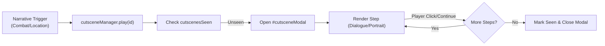

# Cinematic Cutscenes

Galactic Odyssey features a cinematic cutscene system that drives narrative progression, boss introductions, and dramatic story beats via modal overlays and scripted event sequences.

## Files

| File | Role |
|---|---|
| [`systems/cutscene.js`](../systems/cutscene.js) | Core cutscene manager: handles queueing, playback state, dialogue progression, and conditional triggers. |
| [`systems/ui/cutscene-ui.js`](../systems/ui/cutscene-ui.js) | UI renderer for `#cutsceneModal`, updating portraits, typewriter text, and cinematic borders. |
| [`data/cutscenes.js`](../data/cutscenes.js) | Cutscene definitions containing speaker metadata, dialogue lines, background art keys, and trigger conditions. |
| [`index.html`](../index.html) | Markup containing the `#cutsceneModal` container and cinematic letterbox panels. |
| [`systems/combat.js`](../systems/combat.js) & [`systems/locations.js`](../systems/locations.js) | Trigger integration points that check and launch cutscenes at key narrative milestones. |
| [`systems/saveload.js`](../systems/saveload.js) | Persistence handling for `cutscenesSeen` state tracking. |
| [`tests/systems/cutscene.test.js`](../tests/systems/cutscene.test.js) | Unit tests verifying cutscene loading, advancement, persistence, and UI rendering. |

## Flow & Architecture



## API & Persistence

- `playCutscene(id)`: Initiates playback if the cutscene exists and has not already been viewed (unless repeatable).
- `cutscenesSeen`: Array stored within save state tracking viewed cutscene identifiers.

## Testing

```bash
npx jest tests/systems/cutscene.test.js
```

## Known Gaps

- Audio cue synchronization during cutscene dialogue lines is currently stubbed pending sound asset finalization.
