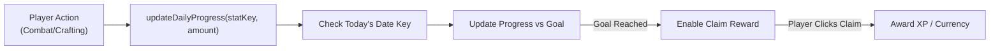

# Daily Challenges & Leaderboards

Galactic Odyssey features daily rotating gameplay challenges and online leaderboards to encourage regular engagement and competitive play.

## Files

| File | Role |
|---|---|
| [`systems/network.js`](../systems/network.js) | Network client communicating with leaderboard and challenge backend endpoints. |
| [`systems/achievements.js`](../systems/achievements.js) | Challenge definitions (`DAILY_CHALLENGES`), progress tracking (`updateDailyProgress`), reward claims (`claimDailyReward`), and date key generation (`getTodayDateKey`). |
| [`systems/ui/achievements-ui.js`](../systems/ui/achievements-ui.js) | UI tab rendering daily challenges, progress bars, and reward claim buttons alongside achievements. |
| [`systems/saveload.js`](../systems/saveload.js) | Persistence handling for `dailyChallenges` state and streak tracking. |
| [`systems/combat.js`](../systems/combat.js), [`systems/crafting.js`](../systems/crafting.js), [`systems/derelict.js`](../systems/derelict.js), [`systems/locations.js`](../systems/locations.js) | Stat hook integration points updating daily challenge metrics (enemies defeated, items crafted, etc.). |
| [`tests/systems/leaderboard.test.js`](../tests/systems/leaderboard.test.js) | Unit tests verifying challenge rotation, progress updates, reward claims, and leaderboard sorting. |

## Flow & Architecture



## Testing

```bash
npx jest tests/systems/leaderboard.test.js
```

## Known Gaps

- Leaderboards currently fall back to cached local scores if network API credentials or backend services are unreachable.
