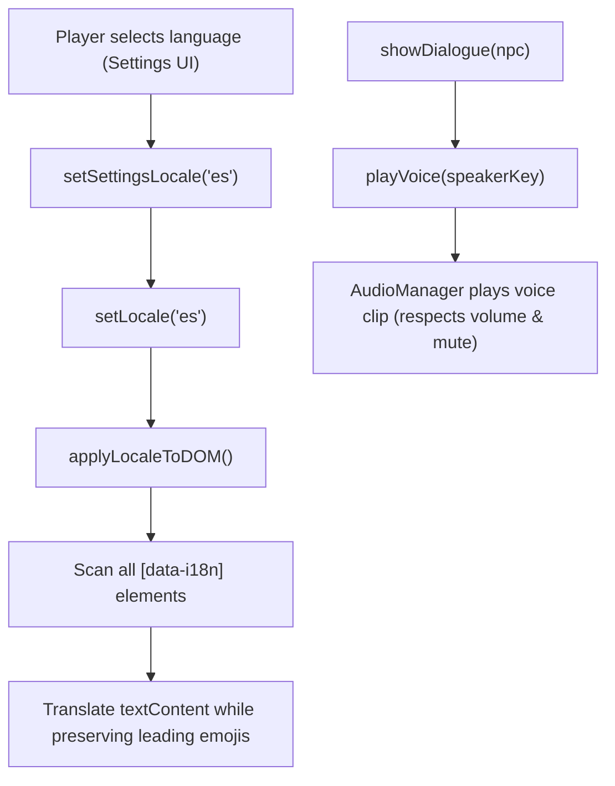

# Localization & Voice-Over Engine

Galactic Odyssey supports multi-language localization (English and Spanish) via `systems/theme-engine.js` and `data/locales.js`, alongside voice-over audio playback integrated into NPC dialogue (`systems/ui/dialogue-ui.js` and `systems/audio.js`) and user settings (`systems/settings.js`).

## Files

| File | Role |
|---|---|
| [`data/locales.js`](../data/locales.js) | Translation dictionaries for supported locales (`en`, `es`) covering UI buttons, HUD labels, combat actions, and menu titles. |
| [`systems/theme-engine.js`](../systems/theme-engine.js) | Locale management (`setLocale`, `getLocale`, `localize`, `applyLocaleToDOM`) preserving leading emojis and restoring English-safe `data-term` attributes. |
| [`systems/settings.js`](../systems/settings.js) | Persistent settings module managing locale, volume, and mute state in `localStorage`. |
| [`systems/ui/settings-ui.js`](../systems/ui/settings-ui.js) | Settings modal UI wiring volume sliders, mute toggles, and language selectors. |
| [`systems/audio.js`](../systems/audio.js) | `AudioManager` methods `playVoice(key)`, `stopVoice()`, handling voice clips with master volume and mute integration. |
| [`systems/ui/dialogue-ui.js`](../systems/ui/dialogue-ui.js) | Automatically triggers `playVoice(speakerKey)` when opening dialogue (`showDialogue`) and `stopVoice()` on close (`hideDialogue`). |
| [`systems/combat.js`](../systems/combat.js) | Refreshes combat UI button labels (`updateCombatUI`) through localized dictionaries. |
| [`index.html`](../index.html) | DOM elements marked with `data-i18n="..."` attributes for automatic translation. |
| [`tests/systems/localization.test.js`](../tests/systems/localization.test.js), [`tests/systems/settings.test.js`](../tests/systems/settings.test.js) | Jest test suites verifying translation accuracy, emoji preservation, DOM updates, and voice playback lifecycle. |

## Architecture & Flow



## Localization API & Rules

- **Dictionaries**: `data/locales.js` exports dictionary maps for each locale code (e.g. `en`, `es`).
- **Data Attributes**: Static HTML elements carry `data-i18n="key"` attributes.
- **Emoji Preservation**: `applyLocaleToDOM()` inspects existing element text content. If a leading emoji (including variation selectors like `⚙️`) is present, it extracts and prepends it to the newly translated string so icons never vanish during language switching.
- **Theme Coexistence**: `data-term` (theme vocabulary) and `data-i18n` coexist harmoniously; theme application runs alongside locale updates.

## Voice-Over System

- **Audio Manager**: `AudioManager` maintains voice playback state (`this.voice`). `playVoice(key)` checks if a voice asset exists, stops any currently playing voice clip (`stopVoice()`), creates a new audio instance, applies current master volume and mute state, and plays it safely via `_safePlay()`.
- **Dialogue Lifecycle**: When `showDialogue(npc)` runs in `systems/ui/dialogue-ui.js`, it identifies the speaker key (e.g. `vance`, `nesta`, `thorne`, `jax`, `lyra`) and triggers `audio.playVoice(speakerKey)`. When dialogue closes (`hideDialogue()`), `stopVoice()` cuts off the audio.

## Testing

```bash
npx jest tests/systems/localization.test.js tests/systems/settings.test.js
```

## Known Gaps

- Voice-over audio clips in `assets/audio/voices/` are currently silent placeholders or stubbed in tests, so voice playback relies on HTML5 Audio simulation under jsdom.
