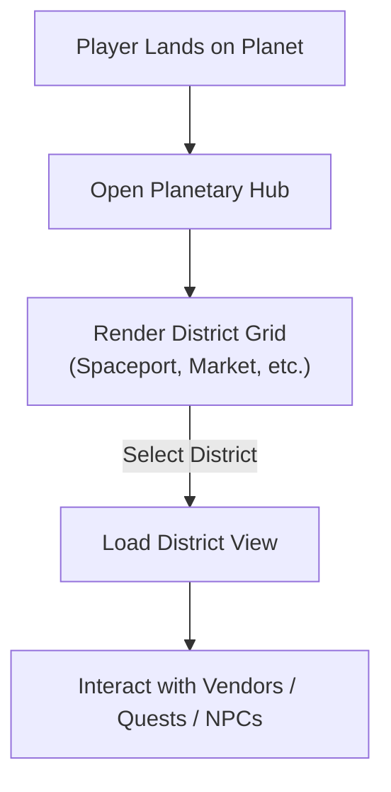

# Planetary Hub

The Planetary Hub system provides an interactive multi-district surface interface when players land on planetary bodies or space stations.

## Files

| File | Role |
|---|---|
| [`systems/ui/planet-hub.js`](../systems/ui/planet-hub.js) | Hub container management, district navigation, and planetary services routing. |
| [`systems/ui/districts-ui.js`](../systems/ui/districts-ui.js) | District-specific views (Spaceport, Market, Slums, Research Labs, Governor's Palace). |
| [`tests/systems/planetHub.test.js`](../tests/systems/planetHub.test.js) | Unit tests verifying hub rendering, district switching, and action dispatching. |

## Flow & Architecture



## Testing

```bash
npx jest tests/systems/planetHub.test.js
```

## Known Gaps

- Dynamic planetary condition modifiers (weather/security lockdowns) are currently visual placeholders.
