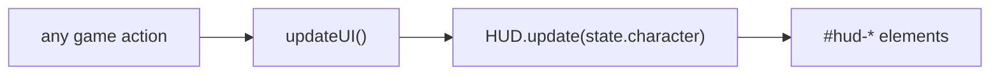

# Cinematic HUD & UI Theme

The exploring screen has a heads-up display (HUD) with hull, energy, and XP bars plus an alert banner. It's styled by its own stylesheet and refreshes whenever the rest of the UI does.

## Files

| File | Role |
|---|---|
| [`assets/css/theme.css`](../assets/css/theme.css) | CSS custom properties (palette, font, backdrop) and all `.hud-*` styles. Linked from `index.html` after `style.css`. |
| [`systems/ui.js`](../systems/ui.js) | `export class HUD` with `static update(character)`. Called from `updateUI()`. |
| [`index.html`](../index.html) | HUD markup at the top of `#exploringScreen`. |
| [`data/theme.js`](../data/theme.js) | Label tokens: `hudHull`, `hudEnergy`, `hudXp`. |
| [`tests/ui/hud.test.js`](../tests/ui/hud.test.js) | Unit tests for `HUD.update` and the `updateUI` → HUD wiring. |

## How it updates



`HUD.update(character)` looks up elements by ID and is a no-op for any element that isn't in the DOM, so it's safe to call on any screen.

| Element ID | Value written |
|---|---|
| `hud-health-fill` | `width` = `hp / maxHp` as a %, clamped 0–100 |
| `hud-health-text` | `"hp / maxHp"` |
| `hud-energy-fill` / `hud-energy-text` | Same, from `energy` / `maxEnergy` (defaults to 100 / full) |
| `hud-xp-fill` / `hud-xp-text` | Same, from `xp` / XP-to-next-level |
| `hud-alerts` | `alerts.join(' \| ')`; adds class `active` when there are alerts, removes it when empty |

**XP to next level** uses `character.xpToNext` if present, otherwise `character.level * 100`. That matches the level-up formula in [`systems/character.js`](../systems/character.js) (`gainXp`). If you change the formula there, change it here too.

**Alerts** read `character.alerts` (an array of strings). Nothing in the game sets this yet, so the banner stays hidden until a system starts pushing alerts.

## Styling

All HUD colors come from custom properties in `:root`, so re-skinning means editing variables, not rules:

| Variable | Used for |
|---|---|
| `--color-danger` | Hull bar, alert banner |
| `--color-primary` | Energy bar |
| `--color-accent` | XP bar |
| `--bg-secondary`, `--bg-panel`, `--border-color`, `--border-glow` | Container and panel chrome |
| `--text-bright` | Bar labels |
| `--panel-backdrop` | `backdrop-filter` blur |

Layout is CSS Grid (`repeat(auto-fit, minmax(280px, 1fr))`), so the three panels stack on narrow screens. The alert banner spans the full row and pulses (`@keyframes hudPulse`). Bar widths animate with a 0.3s transition.

New HUD styling goes in `theme.css` as vanilla CSS. Don't add Tailwind classes to HUD markup.

## Theme vocabulary

Labels carry `data-term` attributes, so `applyThemeToDOM()` rewrites them from `data/theme.js`. To re-skin for another genre, change the token values. For example, set `hudHull: "Vitality"` for fantasy. Don't hard-code label text in the markup or logic.

## Body theme class

`<body class="theme-scifi">` in `index.html` activates the `body.theme-scifi` rule in `theme.css`: the `--bg-primary` page background with a CRT scanline overlay. The rule also sets `font-family: var(--font-family)`, but `style.css` applies Rajdhani to every element via `*`, so in practice the font doesn't change. A future genre skin would swap this class (e.g. `theme-fantasy`, which `applyThemeToDOM()` already knows to remove).

## Known gaps

- The HUD only exists on the exploring screen. Combat keeps its own bars in `updateCombatUI()`.

## Tests

```bash
npx jest tests/ui/hud.test.js
```
