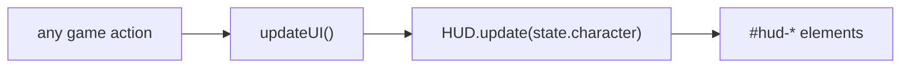

# Cinematic HUD & UI Theme

The exploring screen has a heads-up display (HUD) with hull, energy, and XP bars plus an alert banner. It's styled by its own stylesheet and refreshes whenever the rest of the UI does.

## Files

| File | Role |
|---|---|
| [`assets/css/theme.css`](../assets/css/theme.css) | CSS custom properties (palette, font, backdrop) and all `.hud-*` styles. Linked from `index.html` after `style.css`. |
| [`assets/css/responsive.css`](../assets/css/responsive.css) | Single-viewport (`100dvh`) desktop layout and `< 768px` mobile cockpit/modal rules using Vanilla CSS, Grid, and Flexbox. |
| [`systems/ui.js`](../systems/ui.js) | `export class HUD` with `static update(character)` called from `updateUI()`, plus `initMobileUI()` / `switchMobileTab` wiring. |
| [`systems/ui/mobile-ui.js`](../systems/ui/mobile-ui.js) | Mobile 4-tab cockpit controller (`switchMobileTab`, `getActiveMobileTab`, `initMobileUI`, `MOBILE_TABS`). |
| [`index.html`](../index.html) | HUD markup at the top of `#exploringScreen`, responsive semantic layout classes, and `#mobileNavBar`. |
| [`data/theme.js`](../data/theme.js) | Label tokens: `hudHull`, `hudEnergy`, `hudXp`. |
| [`data/locales.js`](../data/locales.js) | EN/ES translation keys including `mobile_tab_bridge`, `mobile_tab_actions`, `mobile_tab_cargo`, `mobile_tab_status`. |
| [`tests/ui/hud.test.js`](../tests/ui/hud.test.js) | Unit tests for `HUD.update` and the `updateUI` → HUD wiring. |
| [`tests/ui/responsive.test.js`](../tests/ui/responsive.test.js) | Unit tests for `mobile-ui.js` tab switching plus `index.html` and `responsive.css` structural verification. |

## How it updates



`HUD.update(character)` looks up elements by ID and is a no-op for any element that isn't in the DOM, so it's safe to call on any screen.

| Element ID | Value written |
|---|---|
| `hud-health-fill` | `width` = `hp / maxHp` as a %, clamped 0–100 |
| `hud-health-text` | `"hp / maxHp"` |
| `hud-energy-fill` / `hud-energy-text` | Same, from `energy` / `maxEnergy` (defaults to 100 / full) |
| `hud-xp-fill` / `hud-xp-text` | Same, from `xp` / XP-to-next-level |
| `hud-alerts` | `alerts.join(' \| ')`; adds class `active` when there are alerts, removes it when empty |

**XP to next level** uses `character.xpToNext` if present, otherwise `character.level * 100`. That matches the level-up formula in [`systems/character.js`](../systems/character.js) (`gainXp`). If you change the formula there, change it here too.

**Alerts** read `character.alerts` (an array of strings). Nothing in the game sets this yet, so the banner stays hidden until a system starts pushing alerts.

## Styling

All HUD colors come from custom properties in `:root`, so re-skinning means editing variables, not rules:

| Variable | Used for |
|---|---|
| `--color-danger` | Hull bar, alert banner |
| `--color-primary` | Energy bar |
| `--color-accent` | XP bar |
| `--bg-secondary`, `--bg-panel`, `--border-color`, `--border-glow` | Container and panel chrome |
| `--text-bright` | Bar labels |
| `--panel-backdrop` | `backdrop-filter` blur |

Layout is CSS Grid (`repeat(auto-fit, minmax(280px, 1fr))`), so the three panels stack on narrow screens. The alert banner spans the full row and pulses (`@keyframes hudPulse`). Bar widths animate with a 0.3s transition.

New HUD styling goes in `theme.css` as vanilla CSS. Don't add Tailwind classes to HUD markup.

## Theme vocabulary

Labels carry `data-term` attributes, so `applyThemeToDOM()` rewrites them from `data/theme.js`. To re-skin for another genre, change the token values. For example, set `hudHull: "Vitality"` for fantasy. Don't hard-code label text in the markup or logic.

## Body theme class

`<body class="theme-scifi">` in `index.html` activates the `body.theme-scifi` rule in `theme.css`: the `--bg-primary` page background with a CRT scanline overlay. The rule also sets `font-family: var(--font-family)`, but `style.css` applies Rajdhani to every element via `*`, so in practice the font doesn't change. A future genre skin would swap this class (e.g. `theme-fantasy`, which `applyThemeToDOM()` already knows to remove).

## Single-Screen Desktop Layout (`>= 768px`)

[`assets/css/responsive.css`](../assets/css/responsive.css) (linked after `theme.css`) locks the shell to the viewport (`100dvh`, `overflow: hidden`) so desktop play from `1280×720` upward requires no outer page scrolling:

- **Specificity over Tailwind CDN:** Selectors are scoped with IDs (`#exploringScreen ...`, `#combatScreen ...`, `#derelictScreen ...`) and conflicting fixed utility sizes were removed in `index.html` so Vanilla CSS always wins over the runtime Tailwind `<style>` injection.
- **Compacted top bars:** `<header class="app-header">` (~42px), `#hud-container` (single 3-column strip), and `.exploring-row-command` (3 columns). Duplicate `#hpBar`/`#xpBar` meters are hidden on desktop via `.command-duplicate-meters` while keeping their DOM IDs intact for `updateBars()`.
- **Flexible Operations row:** `.exploring-row-ops` uses `flex: 1 1 0; min-height: 0` so `#missionLog`, `#inventory`, `#quickSkillsList`, and `.viewscreen-frame` expand/shrink to fill the remaining height and scroll internally where needed.
- **Pinned Action Console:** `.action-console-grid` renders **6 columns × 2 rows** on `>= 1024px` and **4 columns × 3 rows** on `768px–1023px`.
- **Auto-hiding footer & flexible forms:** `footer.app-footer` hides automatically at `max-height: 760px` and `< 768px`. `#startScreen`, `#characterCreationScreen`, and `#defeatScreen` allow internal vertical scrolling when a form exceeds short viewports.
- **Combat & Derelict:** `#combatScreen` and `#derelictScreen` use `flex: 1 1 0; min-height: 0` on the log/3D feed area with controls pinned at the bottom.

## Mobile Cockpit UI (`< 768px`)

Below `768px`, `#exploringScreen` switches from the 3-row cockpit to a 4-tab single-screen layout controlled by [`systems/ui/mobile-ui.js`](../systems/ui/mobile-ui.js):

- **Bottom navigation (`#mobileNavBar`):** Fixed bottom tab bar with four `>= 44px` (`--touch-target-min`) tap targets (`Bridge`, `Actions`, `Cargo`, `Status`) and `safe-area-inset-bottom` padding. Calling `switchMobileTab(tab)` (exposed on `window.switchMobileTab` via `game.js`) updates `#exploringScreen[data-mobile-tab]` and syncs `.active` + `aria-selected`.
- **Tab panels:**
  - `bridge`: Location card + compact Viewscreen + scrollable Operations Log.
  - `actions`: 2-column grid of all 12 action console buttons (`min-height: 44px`).
  - `cargo`: Full-height Cargo & Gear / Crew & Skills panel.
  - `status`: Personnel Vitals (with `.command-duplicate-meters` re-shown) + Systems Status.
- **Mobile modals & District cards:** Dialog/modal panels constrain to `96vw × 92dvh` with single-column Codex/dialogue layouts, fluid `#planetHubCanvas`, and stacked `#districtsContainer` cards (`flex-direction: column`, un-truncated titles, full-width `>= 44px` action buttons).
- **Localization:** Tab labels carry `data-i18n="mobile_tab_*"` backed by `en` and `es` strings in `data/locales.js`.

## Known gaps

- The HUD only exists on the exploring screen. Combat keeps its own bars in `updateCombatUI()`.

## Tests

```bash
npx jest tests/ui/hud.test.js tests/ui/responsive.test.js
```
